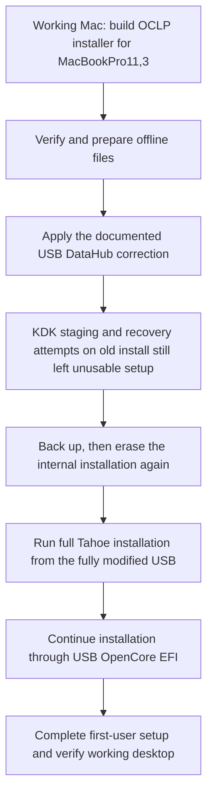

# Tahoe recovery for MacBookPro11,3


**A documented recovery workflow for a mid-2014, 15-inch MacBook Pro with Intel Iris Pro and NVIDIA GT 750M graphics.**

The original clean installation stopped at a repeating Lilu model-information message. After the EFI correction, it reached a wallpaper-only screen before a user account could be created. This project records the changes, supplies an offline preparation tool, and stages OCLP's own root patcher to run before login.

**Reported outcome:** Tahoe works and first-user setup is complete **after a clean reinstall from the fully modified USB**. The owner confirmed that the internal drive was erased again first. Supplying the KDK and attempting repairs on the earlier installation had left the unusable setup screen in place. The erase and reinstall were the final successful step in this case.

> [!IMPORTANT]
> **The final reinstall matters:** complete the USB changes and offline dependency preparation **before** reinstalling. This case did not succeed merely by adding KDK files and rebooting the existing installation. Erasing the internal drive deletes its data; preserve a backup first. This is one machine's observed recovery sequence, not proof that every affected Mac requires an erase.

[What fixed what](#what-fixed-what) · [Prepare the USB](#prepare-the-usb) · [Clean reinstall from the modified USB](#clean-reinstall-from-the-modified-usb) · [Recovery helper](#run-in-recovery) · [Logs and rollback](#logs-and-rollback) · [Full troubleshooting record](docs/CASE-STUDY.md)

> [!IMPORTANT]
> This is an **unofficial, model-specific helper**, not an OCLP fork or an official Dortania release. It modifies the installed system through OCLP's root-patching process. Its guards intentionally accept **MacBookPro11,3 + Tahoe 26.7.1 build 25G241 + OCLP 3.0.0 RC3** only. Review the source and preserve a backup before using it.

## What fixed what

| Observed problem | Change used in this case | What the evidence establishes |
| :--- | :--- | :--- |
| Repeating `Lilu dev: failed to obtain model information, retrying...` | Set explicit DataHub model and board ID; enable `UpdateDataHub` | The owner reported that this cleared the Lilu boot loop. Exact prefix punctuation was not captured reliably. |
| Installer patch log could not find a matching KDK and selected wireless-only patches | Supply the exact **25G241 KDK** offline | The log showed a real missing dependency. Offline availability removes that network dependency. |
| Wallpaper appears, but no usable Setup Assistant, Dock, or menu bar | Finish the USB changes, then **erase the internal drive again and reinstall Tahoe from that USB** | The owner confirms the existing installation stayed unusable despite KDK staging/repair attempts. Working setup followed the clean reinstall. |
| Need to invoke OCLP without a working user session | Stage a one-attempt startup job to invoke RC3 `--patch_sys_vol` before login | This is the custom helper's function. It was not demonstrated to recover the original installation by itself. |
| Custom helper rejects the correct USB in Recovery | Match the **GPT partition UUID**, rather than requiring an HFS filesystem UUID | Recovery reported the partition identity while omitting filesystem identity. This was a bug in the custom helper. |
| Installer volume is mounted read-only | Try a writable source mount; otherwise log to the **same USB's EFI** | No formatting or repartitioning is involved. The target system is not force-remounted by the helper. |
| A wildcard command prints the options instead of running | Use one exact, quoted script path | Both an old `Image Volume` mount and an updated installer mount were visible. The wildcard passed the second script path as an argument. |

### Assets package versus KDK

These are different dependencies, not competing fixes:

| File | Purpose in this workflow | How it is supplied |
| :--- | :--- | :--- |
| `AutoPkg-Assets.pkg` | Provides the authentic RC3 app, privileged helper and bundled patch resources. The preparation tool extracts its app/helper without running its installer scripts. | Downloaded from the pinned official RC3 release, or supplied locally. |
| `KernelDebugKit.pkg` | Provides Apple's kernel resources for the matching OS build. The original log specifically reported this dependency missing. | Taken from the matching official KDK DMG, or supplied locally. |
| `KDK-25G241.tar.gz` | Lets Recovery stage that KDK on the writable Data volume without `pkgutil`. | Built locally from the verified Apple package, including its SDK payload. |
| `RC3-runtime.tar.gz` | Lets Recovery stage the verified RC3 app/helper without executing the AutoPkg postinstall in Recovery. | Built locally from the verified assets package. |
| `recovery-tool` | Small native utility for plist values, SHA-256, and free-space checks, without Python, Perl or newer `plutil` options in Recovery. | Compiled locally for x86_64 from the C source in this repository. |

The assets file does not itself fix graphics. The KDK does not contain OCLP's graphics patches. **The patcher resources and a usable matching KDK work together.** With working networking, OCLP can normally acquire dependencies itself; this case required offline staging. An already installed RC3 app could be another way to supply the app, but this helper deliberately uses a pinned, complete runtime.

The owner had already supplied the KDK during the unsuccessful repair attempts. Success came only after erasing and reinstalling from the fully modified USB. This does **not** establish the exact installer/root-patcher mechanism, or that every manual copy was individually necessary.

## Reported path to working setup



## Prepare the USB

Do this on a **working Mac**, which can be a different computer from the target laptop.

### 1. Start with an OCLP installer

Use **OCLP 3.0.0 RC3** to create a **Tahoe 26.7.1 / 25G241** installer and build OpenCore explicitly for **MacBookPro11,3**. This project does not download macOS, erase a USB, or build OpenCore for you.

Preparation requires Python **3.9 or newer**, Xcode Command Line Tools (`xcrun clang`), and approximately **15 GiB of free host storage**. The expanded packages and generated archives stay on the host while being built. A 32 GB installer USB was used in the original case; available space is checked before deployment.

The native Recovery utility targets Intel x86_64. An Apple silicon preparation Mac also needs the ability to execute that Intel utility during verification; the original preparation host was an Intel iMac.

### 2. Clone and build

```bash
git clone https://github.com/MrCee/oclp-tahoe-mbp113-recovery.git
cd oclp-tahoe-mbp113-recovery

python3 build_kit.py \
  --usb "/Volumes/Install macOS Tahoe" \
  --download \
  --deploy
```

The tool downloads these **pinned official assets**, verifies their SHA-256 hashes, expands them without installing on the host, compiles the native utility, and binds the resulting kit to the selected USB's GPT partition identity. `--deploy` copies the completed kit to the USB; omitting it builds a local kit only.

- [OCLP 3.0.0 RC3 release](https://github.com/dortania/OpenCore-Legacy-Patcher/releases/tag/3.0.0-rc.3)
- [KDK 26.7.1, build 25G241](https://github.com/dortania/KdkSupportPkg/releases/tag/25G241)

> [!NOTE]
> This repo contains **source and documentation**, not macOS installers, OCLP packages, KDK payloads, personal EFI configurations or private logs. Downloads and generated USB-bound files remain in the ignored `build/` folder. The original owner's USB identifiers are not embedded in the public source.

<details>
<summary><strong>Already downloaded the official packages?</strong></summary>

Mount the matching KDK DMG read-only and use its `KernelDebugKit.pkg`:

```bash
python3 build_kit.py \
  --usb "/Volumes/Install macOS Tahoe" \
  --assets-pkg "/path/to/AutoPkg-Assets.pkg" \
  --kdk-pkg "/Volumes/Kernel Debug Kit/KernelDebugKit.pkg" \
  --deploy
```

The same pinned checksum checks apply. There is no skip-verification option. Existing download-cache files are verified before reuse. A changed package must be investigated, not bypassed.

</details>

### 3. Apply the reported EFI correction

The installer and OpenCore must already target the specified model. Mount **the USB's EFI**, verify its disk in Disk Utility or `diskutil list`, then run:

```bash
python3 fix_efi.py \
  --usb "/Volumes/Install macOS Tahoe" \
  --config "/Volumes/EFI/EFI/OC/config.plist" \
  --normal-boot
```

This validates that the config is on the **same external USB**, makes a backup beside it, and applies only:

| Setting | Originally observed | Value used |
| :--- | :--- | :--- |
| `PlatformInfo → DataHub → SystemProductName` | Empty | `MacBookPro11,3` |
| `PlatformInfo → DataHub → BoardProduct` | Empty | `Mac-2BD1B31983FE1663` |
| `PlatformInfo → UpdateDataHub` | `false` | `true` |
| Apple NVRAM `boot-args`, when `--normal-boot` is supplied | Temporary `-x` from a safe-mode test | Remove the `-x` token; retain the other arguments |

The board ID is the shared **MacBookPro11,3 model identifier**, not an ID copied from the preparation Mac. Do not apply that board ID to another model. Rebuilding OpenCore later may replace manual config changes; re-check the result.

### 4. Verify and eject

```bash
/bin/bash "/Volumes/Install macOS Tahoe/repair.sh" --check
```

This checks the manifest, native utility and service plist, and creates a diagnostic log. It does not stage changes on internal macOS. Safely eject the USB when checks pass.

## Clean reinstall from the modified USB

**This was the final step that succeeded on the owner's Mac.** The earlier installation remained unusable after the offline KDK had been supplied and the repair attempts had run. Rebooting that same installation was not sufficient.

1. Complete **all USB preparation first**: the correct OCLP model target, DataHub correction, offline RC3/KDK files, removal of temporary `-x`, and the prepared-kit checks above.
2. Back up any data to preserve. The owner then **erased the internal drive again** in Disk Utility. This is destructive; identify the intended internal target carefully and retain the prepared USB.
3. Boot **Option → USB EFI Boot → Install macOS Tahoe** and run a **full Tahoe installation onto the erased internal target**, using the fully modified USB.
4. During installation restarts, continue through the USB's OpenCore EFI. Select the continuing installation entry when present, then the internal macOS entry once installation is complete. Keep the USB connected while it supplies OpenCore.
5. Boot normally, complete first-user setup and confirm a usable desktop. This was the owner's successful result after the clean reinstall.

This records the sequence that worked on one machine. It does not prove every affected Mac needs an erase, or that a KDK copied to the USB is automatically consumed by every installer path. The helper's explicit staging route is described below; its presence alone was not sufficient to rescue the owner's earlier installation.

## Run in Recovery

**Additional helper route, not a replacement for the clean reinstall reported above.** These script steps require Tahoe **26.7.1 / 25G241 to be installed on the internal disk already**. They describe how to stage dependencies and invoke OCLP when a graphical session is unavailable. The helper does not erase the disk or install macOS. Running it on the owner's previous installation did not, by itself, produce the working result.

Connect the laptop's charger and leave the USB inserted.

1. Hold **Option** at startup; choose **USB EFI Boot**, then **Install macOS Tahoe**.
2. In Recovery, open **Utilities → Terminal**.
3. Run the script from its exact mounted location:

   ```bash
   /bin/bash "/Volumes/Install macOS Tahoe/repair.sh" --repair
   ```

   If Recovery mounted the current USB as `Image Volume`, use:

   ```bash
   /bin/bash "/Volumes/Image Volume/repair.sh" --repair
   ```

4. The script stages its files and restarts after a short notice. Choose **USB EFI Boot → internal MacIntosh** (or your internal volume's actual name). Use a **normal boot**, without Shift.
5. The startup job invokes the official RC3 `--patch_sys_vol` command before login. A user account, Dock, Spotlight and Terminal on the broken setup screen are not required.
6. The custom job automatically disables itself and restarts once only after a zero patcher exit, successful logging, OCLP's completion message, and execution of **both Intel Haswell and NVIDIA Kepler patchsets**.
7. Choose **USB EFI Boot → internal MacIntosh** again and check whether Setup Assistant and the desktop are usable. Script completion alone does not establish recovery. In the owner's case, a subsequent erase and full reinstall from the modified USB was still required.

> [!TIP]
> If the USB was removed and reattached while Recovery stayed open, an old mount may remain visible. Before running anything, identify the copies:
>
> ```bash
> grep 'repair kit v' /Volumes/*/repair.sh
> ```
>
> Then use **one exact quoted path**. Do not run `/bin/bash /Volumes/*/repair.sh`: multiple matches become extra script arguments. Restarting Recovery with the updated USB inserted also avoids stale mounts.

There is no reliable "wait exactly 30 minutes" rule. Cache rebuilding can take time and the screen may stay unusable during it. Inspect the logs to establish whether the job started or finished; the script has no timed force-kill and makes no automatic repeated patch attempts.

## Logs and rollback

| Location | Contents |
| :--- | :--- |
| USB installer volume: `Repair-Logs/` | Recovery preparation and live startup/patcher logs, when writable |
| Same USB's EFI: `Repair-Logs/` | Fallback logging if the installer stays read-only |
| Internal Data: `Library/Application Support/MBP113-Repair/logs/` | Local startup output and a copy of preparation evidence |
| Internal Data: `Library/Application Support/MBP113-Repair/backups/` | Preserved app/helper and previous custom-job configuration |

The log records which USB location was used. An absent or unwritable USB prevents root patching; early startup failures are retained internally. **A zero OCLP exit alone is not treated as success.** Logs can contain serial numbers, paths and identifiers—review them before sharing.

To disable only the custom startup job, boot the USB installer Recovery and run the matching exact path:

```bash
/bin/bash "/Volumes/Install macOS Tahoe/repair.sh" --disable
```

This does not undo OCLP root patches. For root-patch rollback, use the appropriate [upstream OCLP unpatch guidance](https://github.com/dortania/OpenCore-Legacy-Patcher/blob/3.0.0-rc.3/docs/TROUBLESHOOT-APP.md). The original config backup can restore the small EFI change. This helper does not erase disks, create user accounts, skip Setup Assistant or install OpenCore to the internal EFI.

## Scope and evidence

**Why this laptop?** MacBookPro11,3 combines Haswell Iris Pro and Kepler dedicated graphics. The supplied root-patch checks expect both. Dedicated graphics plausibly contributed to the graphics difficulty, but were not proven to cause the model-information error or every setup failure.

**Could this help other Macs?** Offline dependencies, robust partition identification and pre-login CLI patching are useful ideas elsewhere. Model IDs, board IDs, required packages and graphics patchsets are not interchangeable. Other machines remain **unsupported by this helper** until separately reviewed and tested.

**What was unnecessary to repeat?** See the [case study](docs/CASE-STUDY.md) for safe-mode trials, failed Recovery package commands, the original helper UUID assumption and duplicate-mount mistakes. They are documented as troubleshooting history, not required installation steps.

The public packaging layer binds a new USB identity and uses a neutral service label. These packaging changes are tested separately from the owner's original hardware success; they have not been re-tested on a second physical Mac.

## Development and validation

Build the native utility on macOS, then run the tests:

```bash
./scripts/test.sh
```

The suite exercises disposable filesystem fixtures with disk, reboot and patcher commands replaced by stubs. It covers completed and incomplete patch attempts, wrong model/build/volume group, missing USB, read-only installer logging to EFI, damaged payloads, preparation and EFI changes. It never root-patches the development Mac. Details and results are in [TESTING.md](docs/TESTING.md).

## Credits and project boundaries

The actual OpenCore bootloader, OCLP app, dependency handling and graphics patches are the work of **Dortania, OpenCore Legacy Patcher contributors, Acidanthera and their upstream projects**. Apple's KDK remains Apple's work. This project supplies orchestration, native diagnostic helpers and a documented troubleshooting record.

The custom code and documentation were developed with **AI assistance**, then checked with automated tests and the hardware outcome reported above. No upstream endorsement is implied. See [NOTICE.md](NOTICE.md) and [LICENSE](LICENSE).

For an upstream bug, first check existing reports and discuss the evidence in the [OpenCore Patcher Paradise community](https://github.com/dortania/OpenCore-Legacy-Patcher#support), as requested by [OCLP's issue template](https://github.com/dortania/OpenCore-Legacy-Patcher/blob/main/.github/ISSUE_TEMPLATE/bug_report.yml). This repo's issues are for the custom helper and its documentation.
